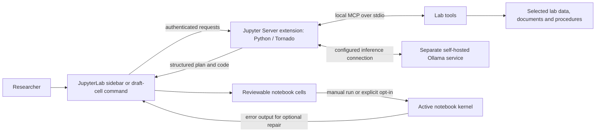

# NaaVRE AI Assistant

A JupyterLab 4 research assistant that turns a scientist's question or Markdown draft into focused, reviewable Python or R notebook cells. It combines optional notebook context, verified table schemas, lab documents and curated procedures with a separately hosted Ollama model.

The extension can investigate a selected lab through bounded MCP tools before generating code. Researchers review the resulting plan and cells, run them in their notebook kernel, and validate the scientific results. Successful execution alone does not establish scientific correctness.

## Features

- Natural-language sidebar for planning and generating a sequence of notebook cells.
- Optional MCP investigation with lab-scoped file discovery, dataset inspection, document search and curated procedures.
- Bounded notebook context and verified CSV/TSV headers to reduce invented files, columns and dependencies.
- Lab knowledge uploads: text-bearing PDF, TXT and Markdown documents, with source excerpts and provenance.
- Markdown draft-cell generation through the toolbar, context menu and command palette; reads NaaVRE `inputs`, `outputs` and `language` metadata.
- Generated cells inserted below the active or source cell without deleting existing cells.
- Execution disabled by default; optional execution with up to three traceback-driven repairs per cell.
- Installable wheel containing both the Python backend and compiled JupyterLab frontend.

## Architecture



The backend runs inside the existing Jupyter Server; it is not a separate Flask or FastAPI application. MCP tools run in a local Python subprocess on the Jupyter host. Model inference is a separate connection and does not give the model direct filesystem access.

The normal investigation tools are `list_files`, `inspect_dataset`, `search_knowledge` and `list_skills`. Tool schemas, arguments, lab permissions and run budgets are checked by the host. Optional `gbif_species_lookup` and `save_note` tools require additional configuration; consequential tool actions require explicit approval. Approving a tool action does not execute generated notebook cells.

Generation has two phases: validated structured planning, followed by generation and checks for each planned cell. A plan can contain up to twenty cells; retries can require additional model calls. Direct generation is available, but does not automatically retrieve all lab documents and procedures. Only an owned, completed investigation is used as investigation evidence for generation.

## Requirements

- Python 3.10 or newer; development restoration was checked with Python 3.12.
- JupyterLab 4.2–4.x and Jupyter Server 2.14–2.x, installed as package dependencies.
- Access to a supported model installed on a self-hosted Ollama service.
- A suitable Python or R notebook kernel and the analysis libraries required by the generated notebook.
- Node.js and npm only when rebuilding the frontend from source. Release-wheel installation does not require Node.js.

The current inference transport uses Ollama's native API. A paid cloud account or `OPENAI_API_KEY` is not required, and arbitrary OpenAI-compatible services are not supported by this transport.

## Install a release

Download a wheel from [Releases](Releases/) and install it into the Python environment that runs the user's Jupyter Server:

```bash
python -m pip install Releases/naavre_ai_assistant-0.2.2-py3-none-any.whl
jupyter server extension list
jupyter labextension list
```

Both extension lists should report the assistant as enabled and valid. Save notebooks and restart Jupyter Server after installation; refreshing the browser alone does not reload Python.

If the same environment also needs a Python kernel and the example analysis libraries:

```bash
python -m pip install 'Releases/naavre_ai_assistant-0.2.2-py3-none-any.whl[notebook,analysis]'
```

The optional `analysis` extra installs pandas, NumPy and Matplotlib. An R kernel and R packages are installed separately. The wheel does not contain datasets, Ollama, model weights, SSH keys or deployment credentials.

## Set up a source checkout

Clone the repository, then run these commands from its root. The scripts locate project files relative to themselves, so the checkout does not depend on a particular drive letter or home directory. Recreate virtual environments and `node_modules` on each computer rather than copying those installations.

### Windows PowerShell

```powershell
powershell -NoProfile -ExecutionPolicy Bypass -File .\naavre-ai-assistant\scripts\bootstrap.ps1
```

### Linux or macOS

```bash
bash naavre-ai-assistant/scripts/bootstrap.sh
```

The bootstrap creates `naavre-ai-assistant/.venv`, installs the application with its development, build, notebook and analysis dependencies, installs frontend dependencies with `npm ci`, and builds the frontend. Python, Node.js and npm must already be available. Use the script's skip-frontend option only when deliberately using the existing compiled bundle; it does not incorporate frontend source changes.

## Connect the model and start a demo

For a local Ollama installation, make the configured model available on `127.0.0.1:11434`. For a remote inference host, an authorized SSH connection can forward that service to the computer running Jupyter:

```bash
ssh -i PATH_TO_YOUR_PRIVATE_KEY -o ExitOnForwardFailure=yes -o ServerAliveInterval=30 -o ServerAliveCountMax=3 -N -L 127.0.0.1:11434:127.0.0.1:11434 USER@INFERENCE_HOST
```

Replace the placeholders with your authorized identity and server. Keep the forwarding terminal open. This command forwards a port; it does not start Ollama or install a model. Do not commit or share the private key.

In a second terminal at the repository root, check local configuration and launch the demo:

```powershell
# Windows
& .\naavre-ai-assistant\.venv\Scripts\python.exe .\naavre-ai-assistant\scripts\start_demo.py --check
& .\naavre-ai-assistant\.venv\Scripts\python.exe .\naavre-ai-assistant\scripts\start_demo.py --model qwen3.8:27b --labs plants
```

```bash
# Linux/macOS
naavre-ai-assistant/.venv/bin/python naavre-ai-assistant/scripts/start_demo.py --check
naavre-ai-assistant/.venv/bin/python naavre-ai-assistant/scripts/start_demo.py --model qwen3.8:27b --labs plants
```

The launcher uses the synthetic lab fixtures in [Testing/fixtures/labs](Testing/fixtures/labs/), selects loopback inference and starts Jupyter on port 8888. Its model choices are `qwen3.8:27b` and `qwen3-coder:30b`; the selected model must already be installed on the inference server. To use both small example labs, pass `--labs plants,energy`.

`--check` checks configuration without contacting the model. With Ollama available, `http://127.0.0.1:11434/api/tags` reports its installed models. The package command `python -m naavre_ai_assistant check --probe` additionally checks whether configured model roles are present; it does not perform inference. Run it with the same environment settings as Jupyter.

Open the token-bearing Jupyter URL printed by the launcher, create a notebook and select its kernel.

## Use the assistant

### Research request

1. Open **NaaVRE AI Assistant** in the sidebar or command palette.
2. Select a lab and the notebook language.
3. Describe the question and optionally include notebook context or upload a protocol as lab knowledge.
4. Select **Investigate with lab tools** to gather evidence. Inspect tool observations and any requested approvals.
5. Select **Build notebook cells**. Inspect the displayed plan and generated source, then run cells in order.

Example request for the plant fixture:

> Compare plant height over time across treatments. Use the lab data and protocol, keep repeated measurements of individual plants visible, and prepare separate cells for the analysis and a chart.

Example request for the synthetic energy fixture:

> Compare electricity use between the two buildings. Check missing and unusual readings using the protocol, compare weekdays and weekends, show a chart and save derived results without changing the input.

Investigating is optional. The build action performs planning and generation consecutively; it does not pause for a separate plan approval. An incomplete, cancelled or outdated investigation is not used as completed evidence.

### Markdown draft cell

Select a Markdown cell describing one component, for example:

```markdown
## Summarize temperature

Read the declared observations CSV. Check that temperature is numeric, report
missing measurements, calculate the mean of valid observations, and save a
one-row summary without modifying the input.
```

Use the notebook toolbar button, **Generate Code from Draft Cell** in the context menu, or **NaaVRE: Generate Code from Draft Cell** in the command palette.

The draft text supplies the request. Optional metadata may be placed at the top level or under the recommended `naavre` key:

```json
{
  "naavre": {
    "language": "python",
    "inputs": {
      "observations.csv": "CSV with a temperature column"
    },
    "outputs": {
      "mean_temperature.csv": "One-row summary containing mean_temperature"
    }
  }
}
```

Input files must exist on the Jupyter host. Resolve paths for the notebook's working directory or the configured lab; a path on a browser user's computer is not a dataset upload. The assistant does not automatically package generated cells as NaaVRE workflow components.

For verified schema checks with portable lab inputs, investigate the selected lab first. Direct relative file references are not automatically inspected by the backend.

### Optional execution and repair

Automatic execution is unchecked by default. Enabling **Also execute cells and repair errors**, or choosing **Generate, Execute, and Repair Draft Cell**, runs generated cells in the active notebook kernel. On a kernel error, the current code, traceback and request context are sent for repair. The repaired source replaces that cell and is retried, with up to three repairs per cell. An unrepaired error stops the sequence and remains visible.

Repairs cannot undo file writes or other side effects from an earlier attempt. Review code and select an appropriate kernel and filesystem scope before opting in.

## Configuration and labs

Set configuration in the environment of the Jupyter Server process and restart it after changes. Automatic dotenv discovery is disabled; `NAAVRE_ENV_FILE` explicitly selects an optional dotenv file.

| Variable | Purpose |
| --- | --- |
| `LOCAL_LLM_BASE_URL` | Loopback URL, normally `http://127.0.0.1:11434/v1`, or authenticated HTTPS gateway URL ending in `/v1`. Native requests use `/api/chat`. |
| `LOCAL_LLM_MODEL` | Supported, installed Ollama model tag; backend default is `qwen3-coder:30b`. |
| `LOCAL_LLM_AGENT_MODEL`, `LOCAL_LLM_ANALYSIS_MODEL`, `LOCAL_LLM_CODE_MODEL` | Optional model overrides for investigation, planning and code. |
| `LOCAL_LLM_THINK` | `auto`, `true` or `false`. |
| `LOCAL_LLM_CONTEXT_WINDOW` | Positive finite context budget. |
| `LOCAL_LLM_TIMEOUT_SECONDS`, `LOCAL_LLM_MAX_TOKENS` | Positive limits or `unlimited`; model/server constraints still apply. |
| `NAAVRE_LABS_DIR` | Lab root on the actual Jupyter host. |
| `NAAVRE_ALLOWED_LABS` | Comma-separated permitted lab IDs. |
| `NAAVRE_AGENT_TOOLS` | Server-owned tool allowlist. |
| `NAAVRE_AGENT_STATE_DIR` | Writable per-user run-state location. |

The backend explicitly permits these model tags: `qwen3-coder:30b`, `qwen3.8:27b`, `qwen3.6:27b`, `qwen3.5:27b`, `qwen3.5:9b`, `qwen3.5:4b`, `devstral-small-2:24b`, `glm-4.7-flash:q4_K_M`, `gemma4:12b` and `gemma4:31b`. This is a configuration allowlist, not a claim that every model has been evaluated equally. Unknown tags and cloud inference are disabled.

Each lab contains `lab.json` and separate `data`, `knowledge`, `skills` and `outputs` directories. Create a new empty lab with:

```bash
python -m naavre_ai_assistant init-lab example --root PATH_TO_LABS --name "Example lab"
```

Configure that root and permitted lab ID before starting Jupyter. Add datasets on the host and configure curated procedures in the profile. The sidebar uploads knowledge documents only: PDF/TXT/MD, up to 4 MiB each. PDFs require extractable text; OCR is not included. Uploaded documents do not automatically become trusted skills or executable instructions.

## NaaVRE deployment and remote inference

Install the wheel in NaaVRE's existing **single-user Jupyter environment or image**. Installing it only in the JupyterHub controller does not install it for users. Mount/configure each user's permitted lab data, writable state, notebook storage and kernel dependencies separately.

An example image extension and inference configuration are in [naavre-ai-assistant/deploy](naavre-ai-assistant/deploy/). They are deployment templates, not a complete NaaVRE rollout. Building a wheel or passing local checks does not establish that the extension has been deployed and tested in the real platform.

`127.0.0.1` inside a remote NaaVRE container means that container. An SSH tunnel on a laptop cannot provide its model connection. Administrators must provide an appropriate route, such as an authenticated HTTPS gateway, a VPN or a supervised SSH forward alongside the backend.

The implemented remote transport requires verified HTTPS, an exact `LOCAL_LLM_REMOTE_HOST`, and either `LOCAL_LLM_CLIENT_CERT` plus `LOCAL_LLM_CLIENT_KEY` or `LOCAL_LLM_API_KEY_FILE` for a gateway that enforces bearer-token authentication. Use `LOCAL_LLM_CA_FILE` for a private CA. Mount secrets into the real Jupyter environment and keep them out of Git and image layers. Unauthenticated remote HTTP, TLS verification bypasses, redirects and ambient HTTP proxies are not supported by this transport.

## Test and build

From the repository root after bootstrap, Windows:

```powershell
Push-Location .\naavre-ai-assistant
& .\.venv\Scripts\python.exe -m pytest -p no:cacheprovider
npm.cmd run lint
npm.cmd run build:lib
node --test ..\Testing\tests\context.test.cjs
# The frontend build invokes Python; use this environment's interpreter.
$env:PATH = "$((Resolve-Path .\.venv\Scripts).Path);$env:PATH"
npm.cmd run build:all
& .\.venv\Scripts\python.exe -m build --wheel --no-isolation --outdir ..\Releases
& .\.venv\Scripts\python.exe ..\Testing\verify_package.py ..\Releases\naavre_ai_assistant-0.2.2-py3-none-any.whl
Pop-Location
```

Linux/macOS:

```bash
cd naavre-ai-assistant
.venv/bin/python -m pytest -p no:cacheprovider
npm run lint
npm run build:lib
node --test ../Testing/tests/context.test.cjs
PATH="$PWD/.venv/bin:$PATH" npm run build:all
.venv/bin/python -m build --wheel --no-isolation --outdir ../Releases
.venv/bin/python ../Testing/verify_package.py ../Releases/naavre_ai_assistant-0.2.2-py3-none-any.whl
```

The automated suite covers schema/path checks, controlled model responses, MCP subprocesses, tool permissions, request handlers, transport policy and independent numerical references. Separate live scripts need an available model; ordinary tests do not establish live inference quality. Strict expected failures retain known weaknesses in frozen historical generated cells and are not counted as successful analyses.

Reviewed historical notebook fixtures retain their original path literals. Their verification harness maps exact reviewed input accesses to the test fixtures; use the demo launcher for a portable example instead of running these archived notebooks directly.

The package verifier installs outside the checkout and exercises an authenticated temporary Jupyter Server with a Hub-style URL prefix. It checks package provenance, routes and frontend delivery using the environment's available dependencies. It does not establish a clean operating-system installation, production NaaVRE deployment or scientific correctness.

## Limitations and future improvements

This is a research prototype. Static validation cannot prove that assumptions, statistical choices, charts or exported results are scientifically correct. Python syntax/import/schema checks are stronger than R checks, and the preserved numerical regression examples are Python-focused. Package availability is inspected in the backend Python environment, which may differ from the selected notebook kernel.

Generated code executes with the notebook user's permissions; the extension provides no operating-system sandbox. Lab-tool path restrictions do not constrain arbitrary notebook code. Requests, selected notebook source, retrieved evidence, and repair tracebacks can be sent to the configured inference service. Storage, access and inference logging remain deployment responsibilities.

Current boundaries include bounded document retrieval, heuristic derived-column checks, occasional overly strict plan decomposition, incomplete handling of some malformed scientific inputs and generated exports, and limited recovery of long-running work after a server restart. Repeat generation can produce different results. Check code, numerical answers, charts, output files and hidden kernel-state assumptions independently.

Potential follow-up work, rather than completed features or required results of the current thesis, includes:

- Better retrieval, OCR and additional scientific data formats.
- Broader R testing and kernel-aware dependency discovery.
- More flexible cell granularity and stronger checks for derived fields, complete exports and chart requirements.
- Durable investigation recovery and repeatable evaluation across real domain tasks and models.
- Reviewed promotion of useful run lessons into reusable curated procedures.
- NaaVRE catalogue search, component metadata, containerizer and experiment-status connectors.
- Automatic container-build remediation, broader workflow orchestration and formal researcher usability studies.

## Repository layout

```text
README.md
naavre-ai-assistant/
  naavre_ai_assistant/   Python server, generation, MCP tools and compiled frontend
  src/                  TypeScript/React JupyterLab extension
  style/                Sidebar styling
  jupyter-config/       Server-extension auto-enable configuration
  scripts/              Portable bootstrap, build and demo helpers
  deploy/               Administrator deployment examples
Testing/
  fixtures/labs/        Small synthetic lab fixtures
  tests/                Automated tests and reviewed notebook fixtures
  ...                   Verification and reference helpers
Releases/               Installable wheels
```

Machine-local environments, dependency caches, credentials, personal learning material and thesis sources are excluded from this public code repository.
