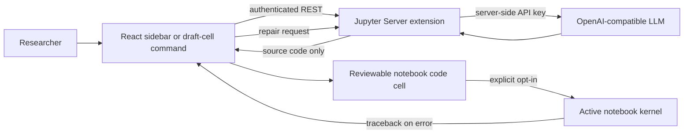

# NaaVRE AI Assistant

`naavre-ai-assistant` is a JupyterLab 4 extension for turning scientific ideas into reviewable Python or R notebook cells. It supports NaaVRE draft-cell generation, opt-in execution, and an LLM-assisted repair loop.

## Features

- Natural-language sidebar for generating a code cell in the active notebook.
- Context-menu, command-palette, and notebook-toolbar actions for Markdown draft cells.
- Reads `inputs`, `outputs`, and `language` from NaaVRE cell metadata.
- Inserts generated code immediately below the source cell for human review.
- Optional execution in the active notebook kernel with up to three repair attempts.

## Architecture



The server does not accept arbitrary kernel execution requests. Generated code runs through JupyterLab's existing `SessionContext`, so execution uses the kernel, variables, permissions, and lifecycle of the active notebook. This also makes the user's opt-in visible at the point where code is generated.

## Requirements

- Python 3.10 or newer
- Node.js 18 or newer, including `npm`
- JupyterLab 4.2 or newer
- An OpenAI-compatible chat-completions API key

On a new Windows machine, Node.js LTS and Python can be installed with:

```powershell
winget install OpenJS.NodeJS.LTS
winget install Python.Python.3.12
```

Open a new terminal after installation so the updated `PATH` is loaded.

## Development Installation

Run these commands from the repository root.

### Windows PowerShell

```powershell
python -m venv .venv
.\.venv\Scripts\Activate.ps1

npm install
npm run build
python -m pip install .
jupyter server extension enable --py naavre_ai_assistant --sys-prefix
```

## Usage

### Generate from natural language

1. Open a notebook and start its kernel.
2. Open **NaaVRE AI Assistant** from the left sidebar or command palette.
3. Describe one workflow component and select Python or R.
4. Leave automatic execution disabled to review the generated cell first.
5. Select **Generate code cell**.

The new code cell is inserted below the currently selected cell. Shared workflow files should use `/tmp/data/`.

### Generate from a draft cell

Create or select a Markdown cell such as:

```markdown
## Calculate mean temperature

Read `/tmp/data/observations.csv`. Validate that the `temperature` column exists,
calculate its arithmetic mean while ignoring missing values, and write one-row CSV
output to `/tmp/data/mean_temperature.csv`.
```

Then use one of these actions:

- Notebook toolbar: **Generate code from the selected Markdown draft cell** icon.
- Cell context menu: **Generate Code from Draft Cell**.
- Command palette: **NaaVRE: Generate Code from Draft Cell**.

For explicit automatic execution, choose **Generate, Execute, and Repair Draft Cell** from the context menu or command palette.

### Draft-cell metadata

The assistant always sends the Markdown source as the component description. It also understands metadata at either the top level or under the recommended `naavre` key:

```json
{
  "naavre": {
    "language": "python",
    "inputs": {
      "observations.csv": "CSV with a numeric temperature column"
    },
    "outputs": {
      "mean_temperature.csv": "One-row CSV containing mean_temperature"
    }
  }
}
```

In JupyterLab, metadata can be edited through **View > Cell Toolbar > Edit Metadata** or the property inspector, depending on the installed JupyterLab configuration.

## Self-Healing Behavior

Automatic execution is disabled by default. When enabled:

1. The generated code is inserted into a new cell.
2. JupyterLab executes that cell in the active kernel.
3. If the kernel returns an `error` output, the traceback, current code, language, and original intent are sent to the repair endpoint.
4. The complete repaired source replaces the generated cell and is executed again.
5. The process stops after success or three failed repair attempts.

Each repair remains visible in the notebook cell. The final error output remains available when all attempts fail.

## Automated Tests

Backend unit tests use a fake OpenAI client and never make network calls:

```powershell
python -m pytest
```

Validate the TypeScript library and production frontend bundle:

```powershell
npm run lint
npm run build:all
```

Confirm that Jupyter sees both halves of the extension:

```powershell
jupyter server extension list
jupyter labextension list
```

Both commands should report `naavre_ai_assistant` or `naavre-ai-assistant` as enabled and valid.

## REST API

All routes inherit Jupyter Server authentication and XSRF protection.

| Method | Route | Purpose |
| --- | --- | --- |
| `GET` | `/naavre-ai-assistant/health` | Backend readiness, configured flag, and model name |
| `POST` | `/naavre-ai-assistant/generate` | Generate code from intent and metadata |
| `POST` | `/naavre-ai-assistant/repair` | Repair code from a kernel traceback |

The API never returns the configured key or base URL.

## Security Notes

- Generated code is untrusted code. Review it before execution whenever possible.
- Self-healing mode executes and modifies a cell. Use it only in a kernel and filesystem scope appropriate for experimental code.
- Generation sends the selected description plus declared inputs, outputs, and language to the configured LLM provider. Repair also sends the generated code and kernel traceback. Other cell metadata is not transmitted.
- The prompt forbids credentials, package installation, shell commands, and service startup, but LLM output still requires user scrutiny.
- The extension does not provide a sandbox. NaaVRE/Kubernetes runtime isolation and normal Jupyter permissions remain authoritative.
- Requests are bounded to reduce accidental oversized prompts, and only Python and R are accepted.

## Troubleshooting

**The sidebar says the server endpoint was not found**

Run `jupyter server extension list`, enable the extension with `jupyter server extension enable --py naavre_ai_assistant --sys-prefix`, and restart JupyterLab.

**The sidebar says `OPENAI_API_KEY` is not configured**

Set the variable before starting JupyterLab. Restarting only the browser tab is not sufficient because the key belongs to the server process.

**The extension does not appear in JupyterLab**

Run `npm run build`, then `python -m pip install .`, and restart JupyterLab. Check `jupyter labextension list` for validation errors.

**Self-healing says no kernel is available**

Select a kernel for the active notebook and wait for its status to become idle before retrying.

**Generated code uses a path outside `/tmp/data/`**

Do not containerize that version. Correct or regenerate it; only `/tmp/data/` is preserved between NaaVRE workflow components.

## Project Layout

```text
naavre-ai-assistant/
|-- src/
|   |-- api/client.ts
|   |-- widgets/AssistantPanel.tsx
|   |-- index.ts
|   `-- notebook.ts
|-- style/index.css
|-- naavre_ai_assistant/
|   |-- __init__.py
|   |-- handlers.py
|   `-- llm_service.py
|-- jupyter-config/jupyter_server_config.d/
|-- tests/test_llm_service.py
|-- package.json
|-- pyproject.toml
|-- setup.py
`-- README.md
```

## Research Scope

This prototype implements the first thesis scenario: generating one workflow component from a researcher-authored draft cell. Agent-based completion of an entire missing workflow, automatic container build-log remediation, and Virtual Lab provisioning are logical follow-up experiments but are deliberately outside this first runnable artifact.
